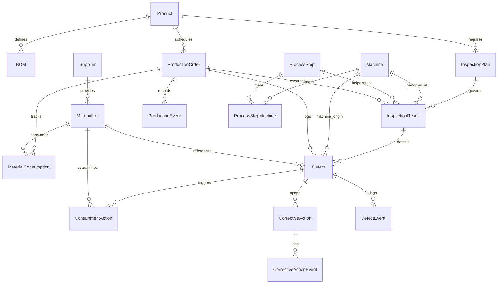

# Manufacturing Defect Traceability & Quality Management System


A complete, production-grade, end-to-end **Manufacturing Defect Traceability & Quality Management System** built with a modular **Python / Flask REST API** backend, **MySQL 8.0 / SQLAlchemy** relational persistence, deterministic synthetic data generator, rigorous automated validation engine, and a modern industrial enterprise **HTML5 / CSS3 / Bootstrap 5 / Chart.js** dashboard.

The system traces defect non-conformances from inspection checkpoints through production orders, BOM hierarchies, material consumption, supplier lots, machines, process steps, containment actions, and closed-loop Corrective and Preventive Actions (CAPA).

---

## 1. Project Overview

In high-precision discrete manufacturing (automotive, aerospace, medical devices, precision hydraulics), defects that escape into downstream processes result in catastrophic scrap costs, line shutdowns, and customer safety hazards. 

This system provides complete **bidirectional traceability**:
- **Backward Traceability:** Start from a detected defect non-conformance and trace back through the exact inspection gate, production work order, bill of materials (BOM), material consumption records, raw material batch/lot, vendor/supplier, machine work center, and process step.
- **Forward Traceability:** Start from a compromised raw material lot or vendor recall notice, and instantly query all affected work orders, assembled products, and inspection records to execute targeted containment and quarantine actions.
- **Closed-Loop CAPA Lifecycle:** Enforces formal root cause analysis, poka-yoke preventive planning, and mandatory verification audits before allowing corrective actions to close.

---

## 2. Business Problem & Objectives

### 2.1 The Problem
- **Siloed Data:** Shop floor machines, quality gate inspectors, warehouse lot receipts, and engineering CAPAs frequently live in disconnected spreadsheets or ERP modules.
- **Root Cause Blindspots:** When a dimensional fracture or porosity defect occurs, quality engineers spend days manually auditing paper traveler sheets to identify which raw material heat lot or machine caused the failure.
- **Lifecycle Violations:** Corrective actions (CAPAs) are frequently marked "Closed" by operators before formal verification audits are executed.
- **Metric Inaccuracies:** Quality defect rates are routinely calculated using improper denominators instead of true inspected units.

### 2.2 Objectives
1. **Traceability Guarantee:** Map every defect directly to product, work order, BOM, material lot, supplier, machine, and step.
2. **Deterministic Data Integrity:** Clean separation of frontend and backend communicating purely via standardized JSON REST APIs.
3. **Rigorous Quality Engine:** Calculate defect rates with proper denominators:
   $$\text{Defect Rate} = \left(\frac{\text{Total Defective Units}}{\text{Total Inspected Units}}\right) \times 100$$
4. **Automated Anomaly Audit:** Detect broken foreign keys, unconsumed BOM items, premature CAPA closures, and quantity mismatches.
5. **Cryptographic Reproducibility:** Ensure identical random seeds produce byte-for-byte identical datasets.

---

## 3. Technology Stack

### Frontend
- **HTML5 & CSS3:** Enterprise industrial theme with dark-blue sidebar (`#0f172a`), clean card surfaces, and accessible typography.
- **Bootstrap 5.3.3:** Responsive grid, modal dialogs, badges, and utility classes.
- **Vanilla JavaScript (ES6+):** Pure modular JavaScript without heavyweight frameworks.
- **Chart.js:** Real-time trends, rework vs. scrap distributions, and supplier/machine Pareto charts.
- **Font Awesome 6.5.2:** Industrial iconography for manufacturing equipment and quality status.

### Backend
- **Python 3.14:** Core language runtime.
- **Flask 3.1.3:** Microframework hosting modular REST blueprints.
- **Flask-CORS 6.0.5:** Secure origin configuration for frontend communication.
- **SQLAlchemy 2.0.52 & Flask-SQLAlchemy 3.1.1:** ORM with connection pooling and atomic transactions.
- **PyMySQL 1.2.4 & mysql-connector-python 9.7.0:** Pure-Python MySQL database drivers.

### Database
- **MySQL Community Server 8.0:** InnoDB transactional storage engine with foreign keys, compound indexes, and ACID guarantees.

### Data Generation & Testing
- **Faker & Random:** Deterministic synthetic data generator using fixed seed `20261022`.
- **Pytest 9.1.1:** Automated test suite covering master data, transactions, CAPA lifecycle, and 5 anomaly scenarios.

---

## 4. Root Architecture & Directory Structure

```
manufacturing-defect-traceability-system/
│
├── frontend/                       # Completely decoupled frontend client
│   ├── css/
│   │   └── style.css               # Enterprise industrial UI styling
│   ├── js/
│   │   ├── api.js                  # Centralized Fetch API client
│   │   ├── dashboard.js            # KPI cards & Chart.js visualizations
│   │   ├── traceability.js         # Interactive pedigree tree visualizer
│   │   ├── modules.js              # Master data, operations & quality views
│   │   └── app.js                  # SPA router & UI event coordinator
│   └── index.html                  # 13-page single-page manufacturing shell
│
├── backend/                        # Completely decoupled Flask REST API
│   ├── config.py                   # Environment configuration & DB URLs
│   ├── app.py                      # Flask application factory & error handlers
│   ├── requirements.txt            # Python dependencies
│   │
│   ├── database/                   # Database connection & transaction scopes
│   │   ├── __init__.py
│   │   └── connection.py
│   │
│   ├── models/                     # 18 SQLAlchemy domain models
│   │   ├── __init__.py
│   │   └── entities.py
│   │
│   ├── routes/                     # Modular REST API endpoints
│   │   ├── __init__.py
│   │   ├── api_master_data.py      # Products, Suppliers, BOM, Machines, Steps
│   │   ├── api_production.py       # Lots, Production Orders, Consumptions
│   │   ├── api_inspection.py       # Inspection Plans & Results
│   │   ├── api_defect.py           # Defects & Containment Actions
│   │   ├── api_capa.py             # CAPA, Verification & Closure
│   │   ├── api_traceability.py     # Multi-tier genealogy graph endpoints
│   │   ├── api_analytics.py        # Dashboard KPIs & Pareto aggregations
│   │   └── api_system.py           # Health, Exports, Audit & Ground Truth
│   │
│   ├── services/                   # Core business logic layer
│   │   ├── master_data_service.py
│   │   ├── production_service.py
│   │   ├── inspection_service.py
│   │   ├── defect_service.py
│   │   ├── capa_service.py
│   │   ├── traceability_service.py
│   │   └── analytics_service.py
│   │
│   ├── validation/                 # Integrity engine & business rules
│   │   ├── __init__.py
│   │   ├── exceptions.py
│   │   └── rules.py
│   │
│   ├── generator/                  # Deterministic synthetic data engine
│   │   ├── __init__.py
│   │   ├── data_factory.py         # Starter & Full scale generators
│   │   ├── anomaly_injector.py     # 5 controlled anomaly scenarios
│   │   ├── exporter.py             # CSV, JSON, SQL seed, and manifest exports
│   │   ├── reproducibility.py      # Double-pass checksum verification
│   │   └── generate_data.py        # CLI generator entrypoint
│   │
│   ├── exports/                    # Generated export artifacts
│   │   ├── ground_truth.json
│   │   ├── ground_truth.csv
│   │   ├── validation_summary.json
│   │   ├── reproducibility_report.json
│   │   ├── source_manifest.json
│   │   ├── data_dictionary.json
│   │   ├── schema.sql
│   │   └── seed_data.sql
│   │
│   └── tests/                      # Automated Pytest suite
│       ├── conftest.py
│       ├── test_master_data.py
│       ├── test_production.py
│       ├── test_inspections_and_defects.py
│       ├── test_capa_lifecycle.py
│       ├── test_traceability.py
│       ├── test_anomaly_scenarios.py
│       └── test_reproducibility.py
│
├── docs/                           # Architecture & schema documentation
│   ├── database_schema.md
│   └── traceability_flow.md
│
├── .gitignore
└── README.md
```

---

## 5. Database Entities & Relationships

The database comprises 18 entities modeled with foreign keys and cascade rules:



### Deterministic ID Formatting Conventions

| Entity | ID Format | Example |
|---|---|---|
| **Product** | `SKU-XXXXXX` | `SKU-000001` |
| **Supplier** | `SUP-XXXXXX` | `SUP-000001` |
| **Material Lot** | `LOT-SUP-XXXXXX-YYYY-XXXXXX` | `LOT-SUP-000001-2026-000001` |
| **Production Order** | `WO-YYYY-XXXXXX` | `WO-2026-000001` |
| **Inspection** | `INSP-WO-YYYY-XXXXXX-XXX` | `INSP-WO-2026-000001-001` |
| **Defect** | `DEF-YYYY-XXXXXX` | `DEF-2026-000001` |
| **Corrective Action** | `CAPA-YYYY-XXXXXX` | `CAPA-2026-000001` |
| **Machine** | `MAC-XXX` | `MAC-001` |
| **Process Step** | `STEP-XXX` | `STEP-010` |

---

## 6. The 5 Labelled Anomaly Scenarios

The system introduces 5 controlled anomaly scenarios to evaluate root-cause discovery and validation engines. Ground-truth labels are stored separately in `backend/exports/ground_truth.json` and `backend/exports/ground_truth.csv`:

| Scenario ID | Name & Description | Injected Condition | Expected System Decision | Severity |
|---|---|---|---|---|
| **SCENARIO_1** | Defect links to nonexistent lot | Defect references `LOT-SUP-999999-2026-999999` | Flags `BROKEN_FOREIGN_KEY_LOT` in validation and traceability audit | `CRITICAL` |
| **SCENARIO_2** | BOM material not consumed | Completed order has 0 consumption for mandatory BOM item | Flags `BOM_MATERIAL_NOT_CONSUMED` exception | `HIGH` |
| **SCENARIO_3** | CAPA closed before verification | CAPA marked `CLOSED` without `verification_date` or `verified_by` | Rejects closure with `LifecycleViolationException` and logs `REJECTED_CLOSURE` event | `MAJOR` |
| **SCENARIO_4** | Defect count exceeds inspected qty | Inspected qty is 10, but defect count is 25 | Rejects transaction with `QuantityValidationException` | `CRITICAL` |
| **SCENARIO_5** | Broken traceability chain | Defect references non-existent work order `WO-2026-999999` | Flags `TRACEABILITY_CHAIN_BROKEN` in audit and renders broken node in UI | `CRITICAL` |

---

## 7. Installation & Configuration

### Prerequisites
- Python 3.10+ (tested on Python 3.14)
- MySQL Server 8.0+
- Modern Web Browser (Chrome, Firefox, Edge)

### Step 1: Clone Repository & Create Virtual Environment
```bash
git clone https://github.com/your-org/manufacturing-defect-traceability-system.git
cd manufacturing-defect-traceability-system

python -m venv venv
# Windows:
venv\Scripts\activate
# Linux/macOS:
source venv/bin/activate
```

### Step 2: Install Python Dependencies
```bash
pip install -r backend/requirements.txt
```

### Step 3: MySQL Database Setup
Create database in MySQL:
```sql
CREATE DATABASE IF NOT EXISTS defect_traceability CHARACTER SET utf8mb4 COLLATE utf8mb4_unicode_ci;
```

### Step 4: Environment Variables
Create a `.env` file in the project root or configure your shell environment:
```env
MYSQL_HOST=127.0.0.1
MYSQL_PORT=3307
MYSQL_USER=root
MYSQL_PASSWORD=
MYSQL_DB=defect_traceability
SECRET_KEY=manufacturing-defect-traceability-secret-key-2026
CORS_ORIGINS=*
PORT=5000
```

---

## 8. Execution Instructions

### Windows (Start Everything with One Command)
From the project root, run:
```bat
run_all.bat
```
The script uses the project virtual environment when available, reuses healthy services, and starts the bundled MySQL instance on port 3307 if needed. The Flask backend also serves the frontend, so both run on one port and one URL: **`http://localhost:5000`**. The script opens the app in your browser after checking database and API health. The frontend is static HTML/CSS/JavaScript, so `npm install` is not required.

### Manual Start
Ensure MySQL 8.0 is running on your configured host and port. Then start the unified frontend and backend server:

```bash
python backend/app.py
```
Open **`http://localhost:5000`**. API endpoints remain available under **`http://localhost:5000/api`**.

### Deploy to Render

The repository includes a Render Blueprint in `render.yaml`. To deploy:

1. Push this repository to GitHub.
2. In Render, choose **New → Blueprint**, connect the repository, and apply the blueprint.
3. Render creates the web service and PostgreSQL database. Wait for the web service health check at `/api/system/health` to pass, then open its `onrender.com` URL.

The web service serves both the dashboard and API. Render supplies `PORT` and `DATABASE_URL`; a generated `SECRET_KEY` is configured by the blueprint. PostgreSQL support is included alongside the local MySQL setup. The first deployment starts with an empty database; to load starter demonstration data, open the service shell and run:

```bash
python -m backend.generator.generate_data --scale starter
```

---

## 9. Synthetic Data Generation

The generator supports deterministic generation with fixed seed `20261022`.

### Starter Scale (Fast Development & Verification)
```bash
python -m backend.generator.generate_data --scale starter
```
*Generates 20 products, 10 suppliers, 100 lots, 200 orders, and 1,000 inspections.*

### Full Scale (Production Quality Scale)
```bash
python -m backend.generator.generate_data --scale full
```
*Generates:*
- **200 Products**
- **50 Suppliers**
- **2,000 Material Lots**
- **5,000 Production Orders**
- **20,000 Inspections**
- **25 Machines** (>= 20)
- **35 Process Steps** (>= 30)
- **600+ BOM Records**
- **14,000+ Material Consumptions**
- **1,500+ Defect Non-Conformances**
- **1,100+ CAPAs**

### Verify Reproducibility
```bash
python -m backend.generator.generate_data --verify-reproducibility
```
*Executes 2 independent generation passes with seed `20261022` and validates that row counts, IDs, CSV checksums, and JSON checksums are identical.*

---

## 10. Automated Test Suite

Execute the comprehensive automated Pytest test suite:
```bash
pytest backend/tests/ -v
```

### Test Coverage Highlights
- `test_master_data.py`: Product creation, duplicate SKU rejection, supplier registration, unique code constraints, BOM item validation.
- `test_production.py`: Material lot receipt, supplier validation, work order creation, material consumption, remaining lot decrement, over-consumption rejection.
- `test_inspections_and_defects.py`: Inspection results, quantity sum validation (`passed + failed == inspected`), defect quantity bounds, containment action triggers, lot quarantine updates.
- `test_capa_lifecycle.py`: CAPA creation, formal verification audit, verified closure, premature closure rejection (Rule 9).
- `test_traceability.py`: Forward/backward traceability graph traversal across 13 linked tiers, broken link detection.
- `test_anomaly_scenarios.py`: Validates detection of all 5 labelled anomaly scenarios.
- `test_reproducibility.py`: Double-pass hash verification ensuring 100% determinism.

---

## 11. REST API Specification

### Master Data
| Method | Endpoint | Description |
|---|---|---|
| `GET` | `/api/products` | List products with pagination and category search |
| `POST` | `/api/products` | Create product (`SKU-XXXXXX`) |
| `GET` | `/api/products/<id>` | Get product by SKU with BOM and inspection plans |
| `GET` | `/api/suppliers` | List approved vendors |
| `POST` | `/api/suppliers` | Register supplier (`SUP-XXXXXX`) |
| `GET` | `/api/boms` | List Bill of Materials items |
| `POST` | `/api/boms` | Add BOM component recipe |
| `GET` | `/api/machines` | List machine work centers |
| `GET` | `/api/process-steps` | List SOP routing stages |

### Shop Floor Operations
| Method | Endpoint | Description |
|---|---|---|
| `GET` | `/api/material-lots` | List material lots with pedigree status |
| `POST` | `/api/material-lots` | Receive material lot (`LOT-SUP-XXXXXX-YYYY-XXXXXX`) |
| `GET` | `/api/production-orders` | List work orders |
| `POST` | `/api/production-orders` | Create work order (`WO-YYYY-XXXXXX`) |
| `POST` | `/api/material-consumptions`| Record consumed material from lot |

### Quality & Defect Management
| Method | Endpoint | Description |
|---|---|---|
| `GET` | `/api/inspections` | List quality inspection results |
| `POST` | `/api/inspections` | Record gate check (`INSP-WO-YYYY-XXXXXX-XXX`) |
| `GET` | `/api/defects` | List non-conformance defects |
| `POST` | `/api/defects` | Log defect non-conformance (`DEF-YYYY-XXXXXX`) |
| `POST` | `/api/defects/<id>/containment` | Quarantine lot / halt line |

### Corrective Actions (CAPA)
| Method | Endpoint | Description |
|---|---|---|
| `GET` | `/api/capas` | List CAPA investigations |
| `POST` | `/api/capas` | Initiate CAPA (`CAPA-YYYY-XXXXXX`) |
| `POST` | `/api/capas/<id>/verify` | Formal QA audit verification sign-off |
| `POST` | `/api/capas/<id>/close` | Final closure approval (rejects if unverified) |

### Traceability & Analytics
| Method | Endpoint | Description |
|---|---|---|
| `GET` | `/api/traceability?type=<type>&id=<id>` | Bidirectional genealogy graph for Defect, SKU, WO, Lot, Supplier, Machine |
| `GET` | `/api/analytics/dashboard` | Real-time KPIs (inspected units, defects, defect rate, rework, scrap) |
| `GET` | `/api/analytics/monthly-trends` | Aggregated monthly defect/rework/scrap trends |
| `GET` | `/api/analytics/suppliers` | Supplier defect count & defect rate Pareto |
| `GET` | `/api/analytics/machines` | Machine rework vs. scrap volume |
| `GET` | `/api/system/validate` | Execute 47,000+ integrity rule checks across DB |
| `GET` | `/api/system/ground-truth` | Get ground truth anomaly labels |
| `GET` | `/api/system/reproducibility` | View double-pass hash verification report |

---

## 12. Frontend Pages Overview

The frontend comprises 13 fully integrated, responsive industrial dashboard pages:

1. **Dashboard:** 10 real-time KPI cards and 7 Chart.js interactive charts powered by live database queries.
2. **Products:** Product catalog with cycle time, standard cost, and active BOM count.
3. **Bill of Materials:** Multi-level component formulas with scrap factors.
4. **Suppliers:** Approved vendor list with quality ratings and lot histories.
5. **Material Lots:** Heat lot inventory, COA certificates, and remaining quantity meters.
6. **Production Orders:** Shop floor work order scheduling and progress tracking.
7. **Machines:** Work center status, maintenance flags, and equipment capability mappings.
8. **Process Steps:** Standard operating routing stages and inspection gates.
9. **Inspections:** Quality checkpoints with pass/fail ratios and inspector sign-offs.
10. **Defects:** Non-conformance log with severity badges, rework/scrap disposition, and direct containment triggers.
11. **Corrective Actions (CAPA):** 8D investigation, root cause, verification sign-off, and closure tracking.
12. **Traceability Tree:** Multi-tier genealogy visualizer with interactive drill-down and red-highlighted broken link diagnostics.
13. **Reports & Audit:** Download CSV/JSON/SQL exports, review ground-truth labels, and audit database integrity.

---

## 13. License & Standards Compliance

Developed in compliance with:
- **ISO 9001:2015 Clause 8.5.2** (Identification and Traceability)
- **IATF 16949 Section 8.5.2.1** (Automotive Component Traceability)
- **FDA 21 CFR Part 820.65** (Medical Device Traceability)
