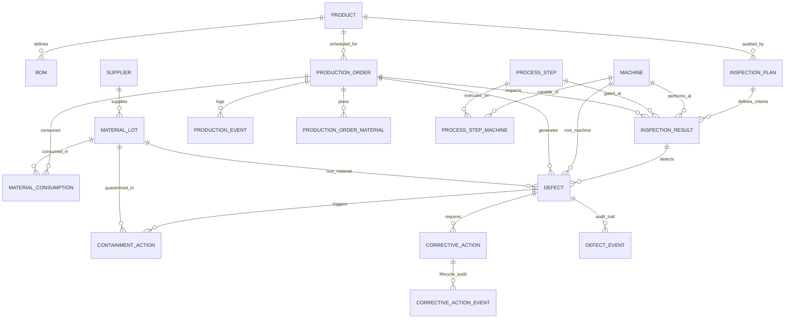

# Database Schema & Entity Relationships

## 1. Overview
The Manufacturing Defect Traceability & Quality Management System utilizes a relational database architecture (MySQL 8.0+ / InnoDB) modeling the entire discrete manufacturing lifecycle from raw vendor supply to production, multi-stage inspection, non-conformance logging, quarantine containment, and closed-loop Corrective and Preventive Action (CAPA).

---

## 2. Entity-Relationship Diagram

---

## 3. Core Entities & Deterministic ID Conventions

| Entity | Deterministic ID Pattern | Primary Purpose | Key Foreign Keys |
|---|---|---|---|
| **Product** | `SKU-000001` | Finished good master item | None |
| **BOM** | Integer PK | Recipe of components and scrap factor | `parent_product_id` &rarr; `Product.id` |
| **Supplier** | `SUP-000001` | Approved raw material vendor | None |
| **MaterialLot** | `LOT-SUP-000001-2026-000001` | Pedigreed incoming batch | `supplier_id` &rarr; `Supplier.id` |
| **ProductionOrder** | `WO-2026-000001` | Manufacturing authorization batch | `product_id` &rarr; `Product.id` |
| **Machine** | `MAC-001` | Shop floor equipment / work center | None |
| **ProcessStep** | `STEP-010` | Standard operating routing stage | None |
| **InspectionPlan** | `IP-SKU-000001-01` | Quality acceptance criteria & AQL | `product_id`, `step_id` |
| **InspectionResult** | `INSP-WO-2026-000001-001` | Quality gate execution record | `inspection_plan_id`, `production_order_id` |
| **Defect** | `DEF-2026-000001` | Non-conformance incident record | `inspection_result_id`, `material_lot_id`, `machine_id` |
| **CorrectiveAction** | `CAPA-2026-000001` | 8D / CAPA root cause & verification | `defect_id`, `containment_action_id` |

---

## 4. Business Integrity Rules
1. **Rule 1 (Valid Products):** Every Production Order must reference a valid, active Product SKU.
2. **Rule 2 (Valid Suppliers):** Every Material Lot must trace back to an authorized Supplier ID.
3. **Rule 3 & 4 (Material Reconciliation):** Material consumptions must reconcile with BOM quantities and decrement available lot inventory.
4. **Rule 5 & 6 (Inspection & Defect Integrity):** Inspections must reference approved plans, and defects must reference valid inspection gates.
5. **Rule 7 (Quantity Bounds):** Defect count cannot exceed inspected sample count (`passed + failed == inspected`).
6. **Rule 9 (CAPA Verification Gate):** No Corrective Action can be closed without formal audit verification by authorized quality personnel.
7. **Rule 10 & 11 (Defect Rate Metric):** Defect rate strictly uses inspected quantity as denominator:
   $$\text{Defect Rate} = \left(\frac{\text{Total Defective Units}}{\text{Total Inspected Units}}\right) \times 100$$

